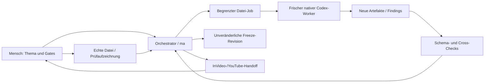

# Architektur

MedizinAnders V1 ist eine Arbeitsumgebung für Codex: Python-CLI, strukturierte lokale Dateien und Git für den Pipeline-Code. Kein Server, keine Datenbank, kein Dashboard und kein eigenes LLM-Gateway. Python 3.11+, JSON Schema und YAML reichen für Zustand und deterministische Prüfungen. Die native Codex-Sitzung übernimmt kreative/recherchierende Worker; der Orchestrator kontrolliert deren Dateiübergaben.

## Zwei getrennte Speicherbereiche

Das Git-Repository enthält Code, Regeln, Schemas, Promptdateien, synthetische Templates, Tests und Dokumentation. Der lokale Datenspeicher enthält Projekte, Rechercheunterlagen, Freigaben, Medien, Reports und private Betreiberkonfiguration. Standard: `~/.local/share/medizinanders`; `MA_DATA_DIR` kann auf einen anderen lokalen Datenspeicher zeigen. Ein Datenspeicher im Git-Repository ist kein empfohlener Betriebsmodus.

```text
DATENSPEICHER/
├── operator.yaml
└── projects/MA-YYYYMMDD-NNN/
    ├── state.json
    ├── artifacts/A01/0.1.0.json ... A12/
    ├── jobs/JOB_ID/input/ ... output/
    ├── review/
    ├── gates/
    ├── freeze/r001/ ... r002/
    ├── handoff/invideo/ ... youtube/
    ├── 08_produktion/inbox/preview.mp4
    ├── 09_postproduktion/inbox/final.mp4
    ├── 10_qa/
    └── 12_analytics/
```

## Zuständigkeiten

`storage.py` verwaltet atomische Dateien, Sperren, Artefakte und SHA-256. `validation.py` prüft Schemas und fachliche/zeitliche Konsistenz. `pipeline.py` verwaltet Zustand, Gates, Freeze, Jobs, Handoffs und Invalidierung. `workers.py` bereitet begrenzte Workerinputs vor. `media.py` prüft echte Dateien mit ffprobe/FFmpeg und SRT-Formalregeln. `cli.py` bietet die wenigen Betreiberbefehle. Der Implementierungsvertrag ist in `implementation-contract.md` dokumentiert.



## Native Ausführung ohne erfundene Agents

Die tatsächlich verfügbare Codex-Kollaborationsschnittstelle erlaubt frische Subagents mit `fork_turns="none"`. Das ist keine dauerhafte Registrierung von „GAMMA“ oder „ALPHA“. Die Rollen sind reproduzierbare Promptdateien. Jede Ausführung startet neu, erhält ausschließlich ihren Job und legt Outputs an einem definierten Ort ab.

`ma run ID` erstellt einen Job und meldet bei fehlender automatischer Sitzungseinbindung `WAITING_FOR_CODEX`. In der nativen Sitzung liest der Orchestrator nur den Jobauftrag und startet die Rolle über die vorhandene Subagentfunktion. `ma worker-complete ID --job JOB_ID` importiert fertige Joboutputs. Ein separater CLI-Modus ist nur nutzbar, wenn die tatsächliche `codex exec`-Installation und ihre Flags geprüft wurden. Eine fehlende native Funktion wird als Einschränkung ausgegeben, nicht simuliert. Kein OpenAI-API-Key ist notwendig.

Die Inputs sind fachlich getrennt: RESEARCH erhält A01, ALPHA nur A01/A02 und Originalquellen, BETA nur A03 und Produktionsregeln. Für BETA enthält A03 einen deterministisch aus tatsächlich referenzierten Originalquellen erzeugten `quellenkatalog` mit `quelle_id`, `url`, `titel`, `zugriff`, `sha256`. Die notwendige Bibliografie benötigt damit keinen A02-Vollkontext. QA bekommt die freigegebene Claim-Basis und zu prüfende Outputs, keine Vorgängergedanken. Diese Grenze reduziert Kontextübernahme und Bestätigungsfehler. Sie ist keine Betriebssystem-Sandbox: Die gemeinsame Umgebung bleibt technisch zugänglich. Rollenprompts verbieten das Lesen fremder Pfade; Outputs werden validiert und unabhängig geprüft.

## Vertrauen und Beweise

Ein JSON-Status `freigegeben` ist kein hinreichender Beweis. Ein gültiger Gate-Datensatz bindet Identität, Zeitpunkt, konkrete Versionen, Hashes und relevante Regeln. Eine Änderung lässt die betroffenen Freigaben ungültig werden. Fachreview und Gate sind getrennte menschliche Entscheidungen. Für echte Medien bindet die Freigabe die Datei-SHA-256; Plattformkontrolle bindet zusätzlich die private Video-ID/URL und die aktuelle Uploadfassung.

Fachreview hat zwei unabhängige Bindungen: `claims` auf A01–A03 vor G2 und bei relevanten Episoden `production` auf A01–A06 vor G3. Ein Claimreview prüft keinen späteren BETA-Wortlaut. Freier Artefaktimport ist auf A01–A06 begrenzt; A07–A12 entstehen über die zuständigen Orchestrator-/Operatorbefehle und echte Nachweise.

Schema- und Cross-Checks prüfen explizite Kennzeichnungen und Beziehungen. Sie können nicht beweisen, dass ein als `faktisch: false` deklarierter Satz tatsächlich keine versteckte Tatsachenbehauptung enthält oder dass ein Risiko richtig erkannt wurde. Dafür sind der frische ALPHA-/QA-Kontext und die menschlichen Inhalts-/Fachprüfungen nötig. Bei Unsicherheit blockieren und die Einordnung prüfen lassen.

Dateihashes beweisen Unverändertheit, nicht Wahrheit und nicht die Identität des Menschen. Die interaktive CLI dokumentiert eine verantwortliche menschliche Bestätigung, keine rechtssichere digitale Signatur. Wer Schreibzugriff auf den Datenspeicher hat, kann Daten manipulieren; Hashvergleiche und erneute Validierung erkennen Änderungen innerhalb des vorgesehenen Workflows. Zugriffsrechte und Backups bleiben G0-Betreiberaufgaben.

## Sicher blockieren

Fehlende Originalquelle, offene K0/K1, fehlende anwendbare Pflichtprüfung, ungeklärter Review, ungültiger Gate oder veränderte Eingabe blockieren abhängige Arbeit. Der Orchestrator bereitet jeweils die nächste konkrete manuelle Handlung vor. Ein Human Gate wird weder aus einem Workerbericht noch aus einem erfolgreichen technischen Test abgeleitet. DEMO-Zustände sind von produktiven Gates getrennt.
